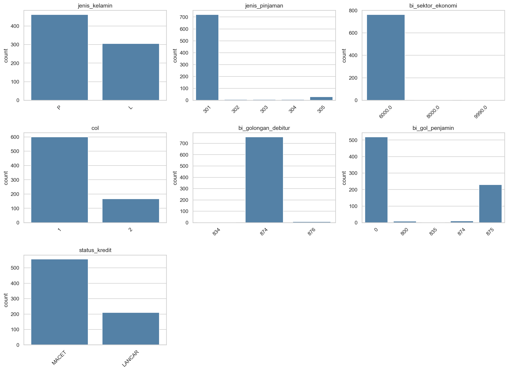
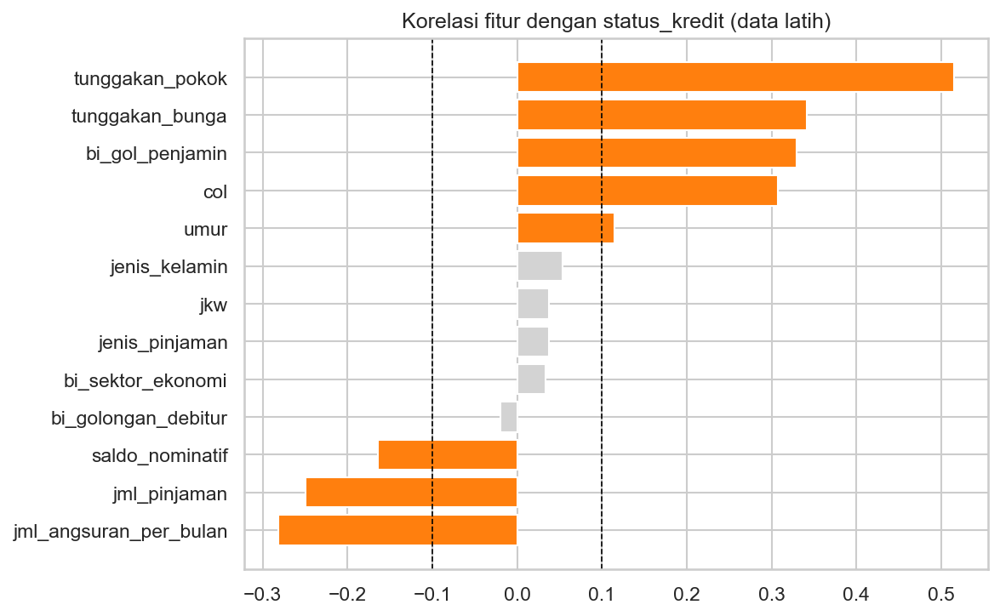
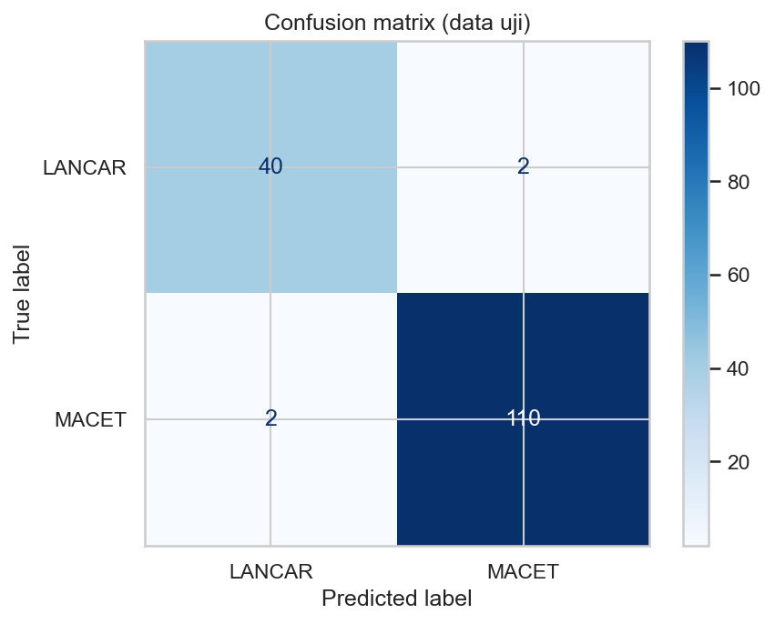
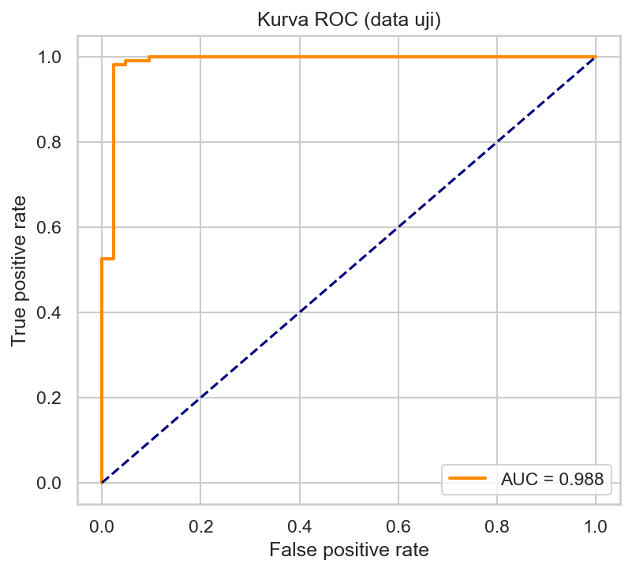

# Credit Approval: Prediksi Status Kredit Nasabah

Klasifikasi status kredit nasabah (LANCAR atau MACET) dari 766 data pinjaman. Proyek ini dikerjakan pada uji kompetensi BNSP skema Associate Data Scientist, dengan waktu beberapa jam. Notebook di repositori ini adalah versi yang sudah saya rapikan dan benahi urutan pemrosesannya.

Model terbaik, CatBoost yang dipilih otomatis oleh mljar-supervised, mencapai akurasi 0,974 pada data uji. Uji tambahan memperlihatkan bahwa hasil itu hampir seluruhnya bersumber dari kolom tunggakan, dan bagian itu dibahas di bawah.

## Hasil pada data uji

| Metrik | Nilai |
|---|---|
| Akurasi | 0,974 |
| Precision (MACET) | 0,982 |
| Recall (MACET) | 0,982 |
| F1 (MACET) | 0,982 |
| AUC | 0,988 |
| Pembanding: menebak MACET untuk semua nasabah | 0,727 |

Dari 154 nasabah di data uji, 4 salah diprediksi.

## Data

Dataset berisi 766 nasabah dengan 16 kolom, dan nama nasabah sudah dianonimkan. Sebanyak 556 nasabah (72,6%) berstatus MACET dan 210 (27,4%) LANCAR, sehingga model yang selalu menjawab MACET sudah benar di sekitar 73% data. Angka itu menjadi pembanding.

Datanya sengaja dibuat kotor, dan sebagian besar pekerjaan ada di pembersihan:

| Masalah | Temuan | Penanganan |
|---|---|---|
| Format angka | lima kolom uang terbaca sebagai teks karena desimal memakai koma | titik ribuan dihapus, koma diganti titik |
| Jenis kelamin | enam variasi tulisan untuk dua kategori | dipetakan ke 0 (laki-laki) dan 1 (perempuan) |
| Umur | 27 nilai di luar 17 sampai 80 tahun, dari -7.162 sampai 1.043 | dikosongkan lalu diisi median data latih |
| Nilai kosong | `umur` 9 baris, `jkw` 8 baris, `bi_sektor_ekonomi` 1 baris | median untuk angka, modus untuk kode |
| Kolom tak berguna | `nama_nasabah` (ID), `type_pinjaman` (bernilai 100 di semua baris) | dibuang |
| Nilai ekstrem | `jml_pinjaman` sampai 228,7 juta dengan median 1,5 juta | dipotong di batas IQR dari data latih |
| Saldo negatif | 3 baris, terendah -4.000.000 | ikut dipotong oleh aturan IQR |



Hampir semua pinjaman berjenis 301, debitur berada di golongan 874, dan sektor ekonominya 6000, sehingga kolom-kolom itu nyaris tidak membedakan nasabah. Nasabah perempuan sekitar 60% dari seluruh data.

## Alur pengerjaan

Data dibagi lebih dulu menjadi 612 baris latih dan 154 baris uji (stratified, `random_state=42`). Semua nilai yang dihitung dari data, yaitu median, modus, batas outlier, daftar fitur, dan parameter scaler, diambil dari data latih saja lalu diterapkan ke data uji.

Seleksi fitur memakai korelasi dengan target (ambang 0,1 pada nilai absolut) dan menyisakan 8 dari 13 fitur.



Tunggakan pokok punya korelasi terkuat dengan status MACET (0,52). Di bawahnya ada tunggakan bunga, golongan penjamin, dan `col` (0,31 sampai 0,34). Jumlah pinjaman dan angsuran per bulan berkorelasi negatif lemah (sekitar -0,25 dan -0,28).

## Model

Pelatihan memakai mljar-supervised mode Explain, batas waktu 300 detik, metrik akurasi. mljar membagi data latih lagi menjadi 75% untuk melatih dan 25% untuk validasi, jadi akurasi di tabel berikut adalah akurasi validasi.

| Model | Akurasi validasi |
|---|---|
| Baseline | 0,725 |
| CatBoost | 0,987 |
| Ensemble | 0,987 |
| XGBoost | 0,967 |
| Random Forest | 0,967 |
| Linear | 0,961 |
| Decision Tree | 0,954 |
| Extra Trees | 0,954 |
| Neural Network | 0,941 |
| Nearest Neighbors | 0,935 |

LightGBM ikut dijadwalkan tetapi gagal saat training di mesin saya, jadi tidak muncul di tabel. CatBoost dan Ensemble seri di posisi teratas, dan mljar memilih CatBoost. Selisihnya dengan XGBoost dan Random Forest hanya sekitar tiga prediksi dari 153 data validasi.

## Evaluasi

| | Latih | Uji | Selisih |
|---|---|---|---|
| Akurasi | 0,987 | 0,974 | 0,013 |
| Precision | 0,987 | 0,982 | 0,005 |
| Recall | 0,996 | 0,982 | 0,013 |
| F1 | 0,991 | 0,982 | 0,009 |
| AUC | 0,995 | 0,988 | 0,007 |

Selisih latih dan uji kecil, jadi overfitting tidak terlalu parah. Kelas LANCAR yang jumlahnya lebih sedikit tetap terdeteksi dengan baik: precision dan recall sama-sama 0,95 dari 42 nasabah.

| Confusion matrix | Kurva ROC |
|---|---|
|  |  |

## Seberapa jauh model bergantung pada tunggakan

Tunggakan pokok, tunggakan bunga, dan `col` adalah fitur dengan korelasi terkuat, dan secara bisnis ketiganya sudah menggambarkan kredit yang bermasalah. Saya mencoba Random Forest pada tiga skenario untuk melihat berapa banyak kemampuan model yang berasal dari sana.

| Skenario | Jumlah fitur | Akurasi uji | AUC uji |
|---|---|---|---|
| Semua fitur terpilih | 8 | 0,974 | 0,992 |
| Tanpa `col` | 7 | 0,974 | 0,995 |
| Tanpa `col` dan kedua tunggakan | 5 | 0,766 | 0,826 |
| Pembanding: menebak MACET untuk semua | - | 0,727 | - |

Membuang `col` tidak mengubah hasil, jadi kolom itu tampaknya tidak membawa informasi di luar tunggakan. Membuang kedua kolom tunggakan menurunkan akurasi ke 0,766, hanya sekitar empat poin di atas pembanding, dan AUC turun dari 0,992 ke 0,826. Fitur yang tersisa (jumlah pinjaman, angsuran, saldo, penjamin, dan umur) masih memberi sinyal, tetapi lemah.

Jadi akurasi tinggi di atas lebih tepat dibaca sebagai kemampuan mengenali kredit yang sudah menunggak, bukan memperkirakan kredit mana yang akan bermasalah. Tunggakan baru muncul setelah pinjaman berjalan, sehingga model ini belum cocok untuk memutuskan persetujuan kredit baru.

## Perbedaan dari notebook ujian

| Bagian | Notebook ujian | Notebook ini |
|---|---|---|
| `nama_nasabah` | ikut di-encode dan terpilih sebagai fitur | dibuang |
| Urutan pemrosesan | imputasi, capping, seleksi fitur, dan scaling sebelum data dibagi | data dibagi lebih dulu |
| Umur tidak wajar | dipotong dengan aturan IQR | nilai di luar 17 sampai 80 tahun dikosongkan lalu diisi |
| Pembagian data | acak | acak dengan proporsi kelas dijaga |
| Uji tambahan | tidak ada | skenario tanpa kolom tunggakan |

Akurasi uji di notebook ujian adalah 0,9675 dan sekarang 0,974. Selisih 0,0065 setara satu prediksi dari 154 data uji, dengan pembagian data yang juga berbeda, jadi saya tidak menganggapnya sebagai perbaikan model. Yang berubah adalah cara hasilnya diperoleh.

## Keterbatasan

Datanya hanya 766 baris dari satu sumber dan dievaluasi dengan satu kali pembagian latih-uji, jadi angka di atas lebih tepat dibaca sebagai kisaran. Uji tanpa tunggakan memakai satu model pembanding dan tidak memisahkan tunggakan pokok dari tunggakan bunga. Batas umur 17 sampai 80 tahun dan perlakuan saldo negatif adalah aturan sederhana dari saya, belum dikonfirmasi ke pemilik data.

## Menjalankan

Dataset berasal dari soal ujian dan tidak disertakan di repositori ini. Untuk menjalankan notebook, letakkan filenya di folder yang sama dengan nama `creditapproval-data kotor.csv` (pemisah titik koma).

```bash
pip install pandas numpy matplotlib seaborn scikit-learn mljar-supervised
jupyter notebook Credit_approval_clean.ipynb
```

Grafik tersimpan otomatis ke folder `images/`, dan hasil AutoML ke `automl_results/`. Hapus folder `automl_results/` sebelum menjalankan ulang dengan data atau fitur yang berbeda, karena mljar akan memuat hasil lama kalau folder itu masih ada.

## Isi repositori

```
Credit_approval_clean.ipynb   notebook yang sudah dirapikan
Credit_approval.ipynb         notebook asli saat ujian
images/                       grafik yang dipakai di README
```
