# Summary of 3_Linear

[<< Go back](../README.md)

## Logistic Regression (Linear)
- **n_jobs**: -1
- **explain_level**: 2

## Validation
 - **validation_type**: split
 - **train_ratio**: 0.75
 - **shuffle**: True
 - **stratify**: True

## Optimized metric
accuracy

## Training time

20.1 seconds

## Metric details
|           |    score |    threshold |
|:----------|---------:|-------------:|
| logloss   | 0.18066  | nan          |
| auc       | 0.972758 | nan          |
| f1        | 0.973214 |   0.469553   |
| accuracy  | 0.960784 |   0.469553   |
| precision | 0.988372 |   0.930422   |
| recall    | 1        |   0.00566418 |
| mcc       | 0.901544 |   0.521902   |

## Metric details with threshold from accuracy metric
|           |    score |   threshold |
|:----------|---------:|------------:|
| logloss   | 0.18066  |  nan        |
| auc       | 0.972758 |  nan        |
| f1        | 0.973214 |    0.469553 |
| accuracy  | 0.960784 |    0.469553 |
| precision | 0.964602 |    0.469553 |
| recall    | 0.981982 |    0.469553 |
| mcc       | 0.900565 |    0.469553 |

## Confusion matrix (at threshold=0.469553)
|              |   Predicted as 0 |   Predicted as 1 |
|:-------------|-----------------:|-----------------:|
| Labeled as 0 |               38 |                4 |
| Labeled as 1 |                2 |              109 |

## Learning curves
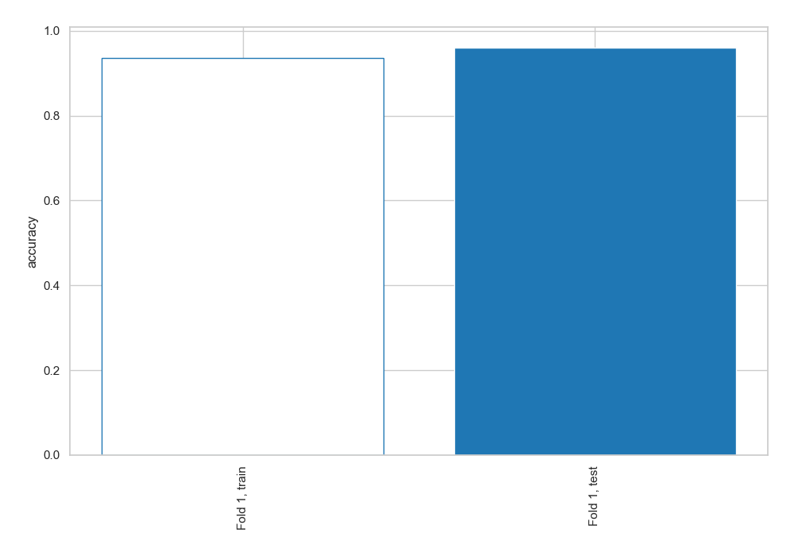

## Coefficients
| feature                |    Learner_1 |
|:-----------------------|-------------:|
| intercept              |  3.02496     |
| tunggakan_pokok        |  2.71554     |
| tunggakan_bunga        |  1.32779     |
| bi_gol_penjamin        |  1.11784     |
| col                    |  1.08104     |
| umur                   |  0.0537526   |
| saldo_nominatif        |  0.000665375 |
| jml_angsuran_per_bulan | -0.13982     |
| jml_pinjaman           | -1.43455     |

## Permutation-based Importance
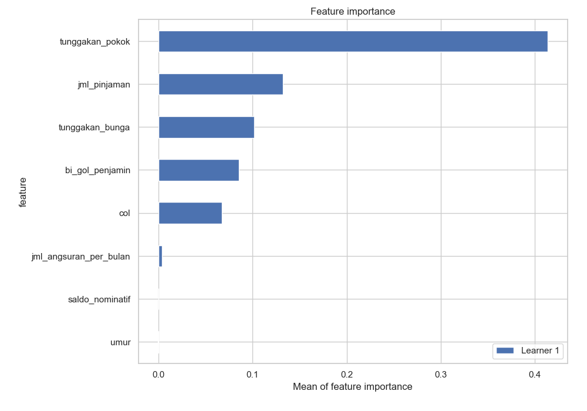
## Confusion Matrix

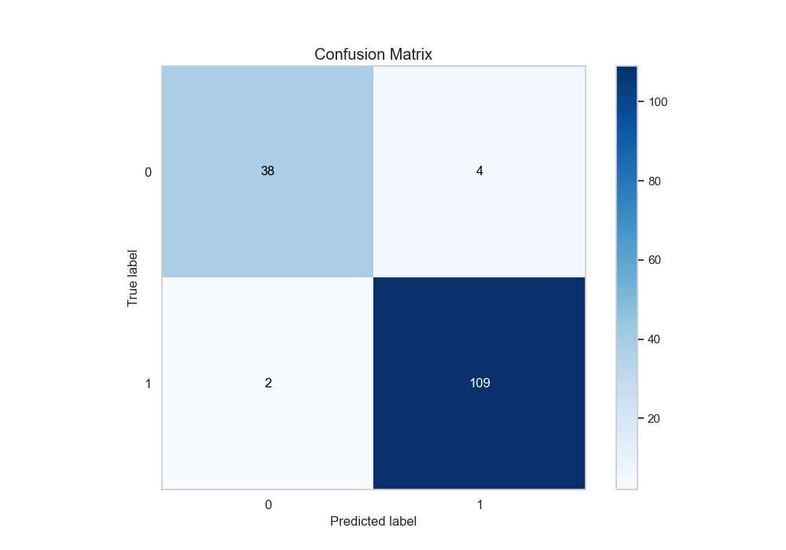

## Normalized Confusion Matrix

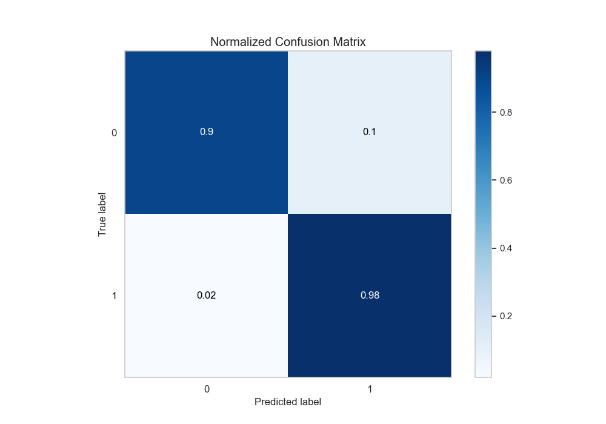

## ROC Curve

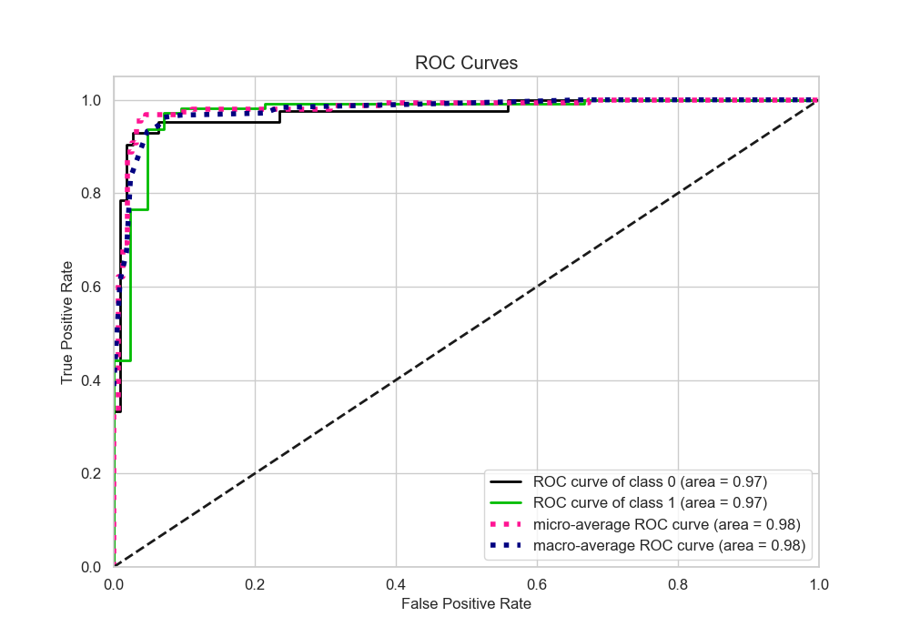

## Kolmogorov-Smirnov Statistic

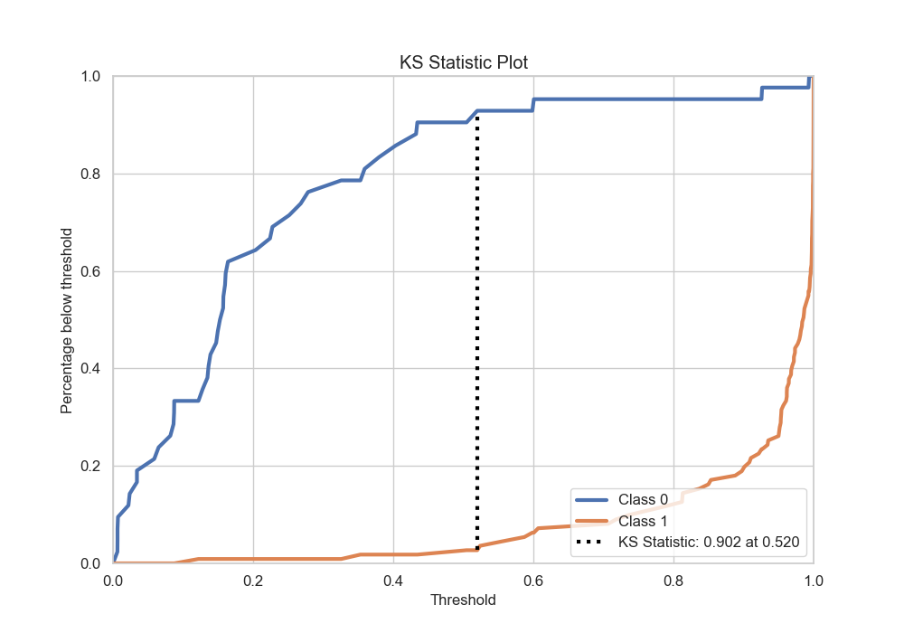

## Precision-Recall Curve

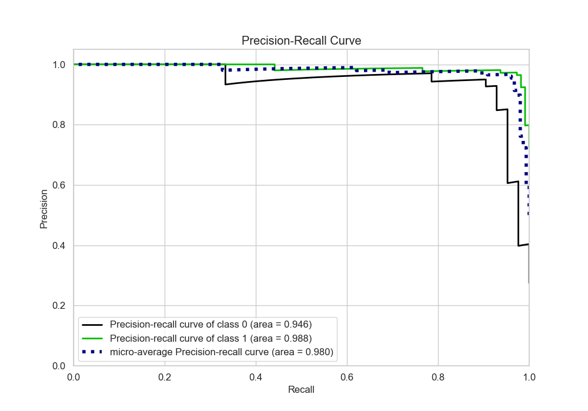

## Calibration Curve

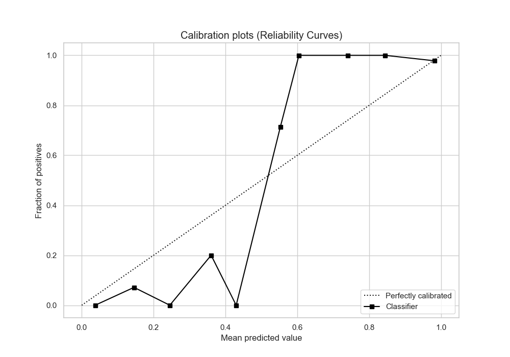

## Cumulative Gains Curve

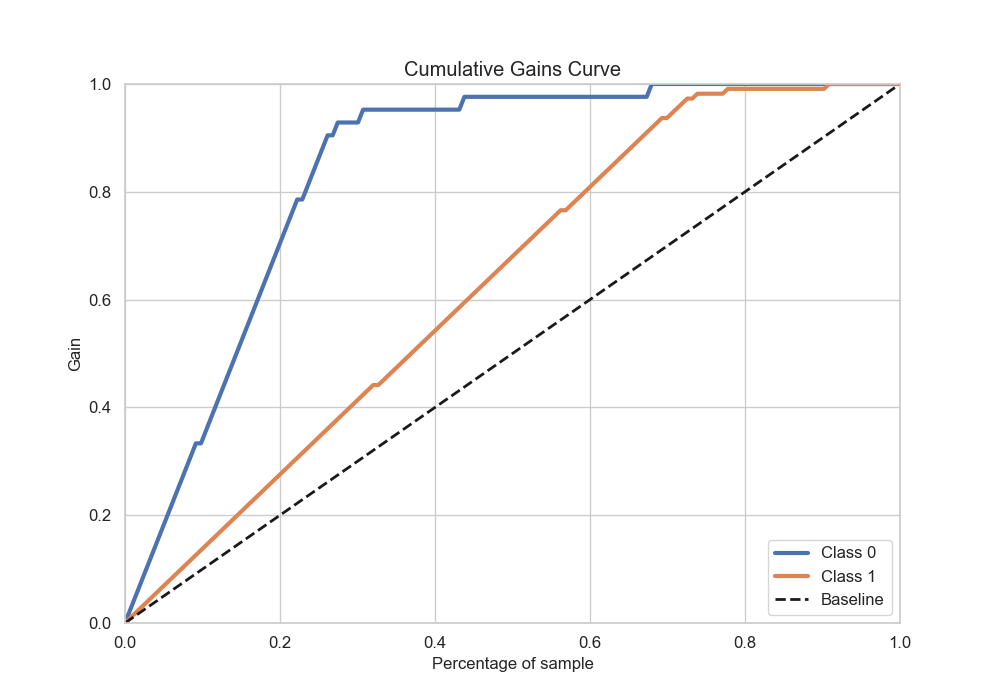

## Lift Curve

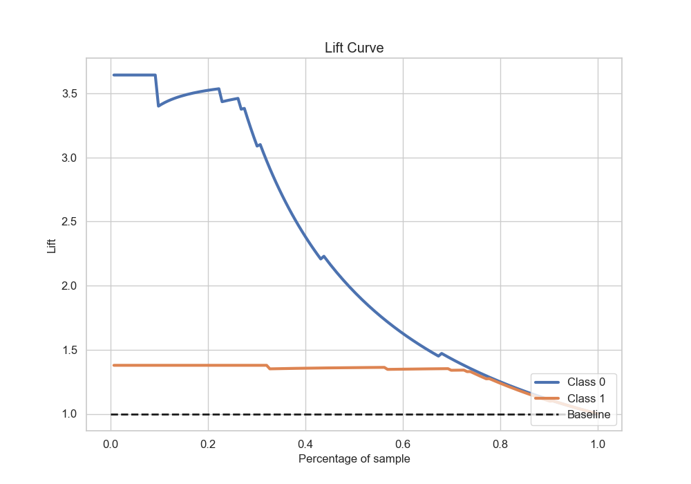

## SHAP Importance
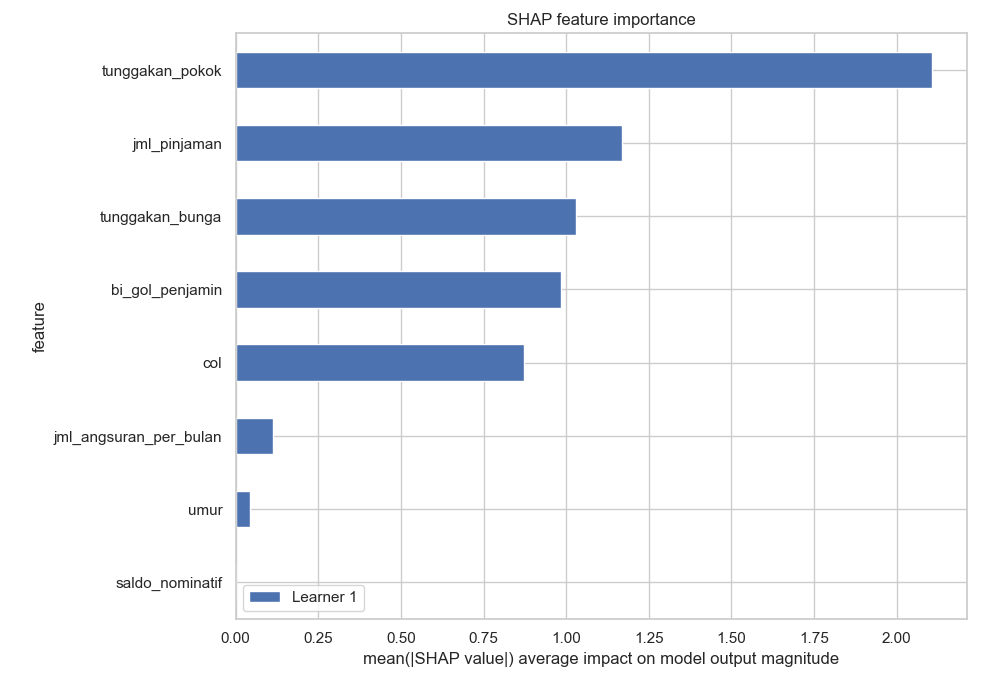

## SHAP Dependence plots

### Dependence (Fold 1)
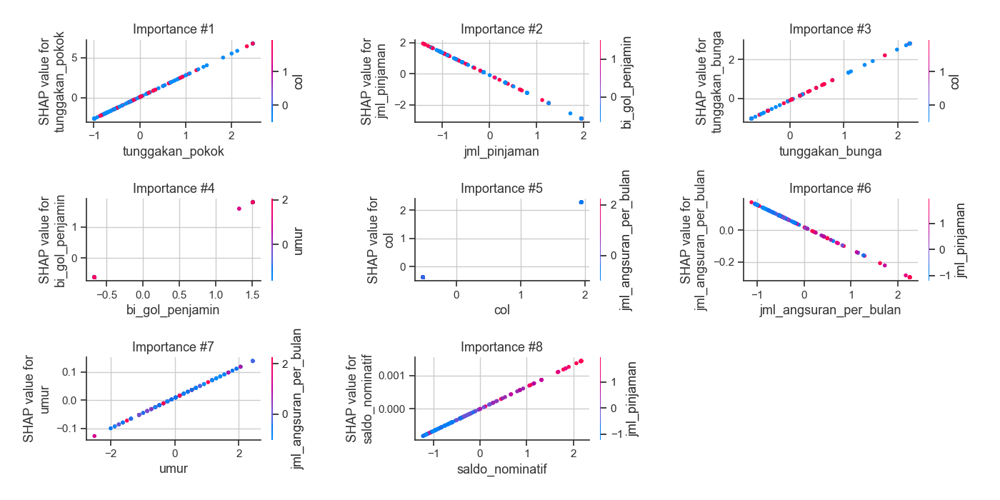

## SHAP Decision plots

### Top-10 Worst decisions for class 0 (Fold 1)
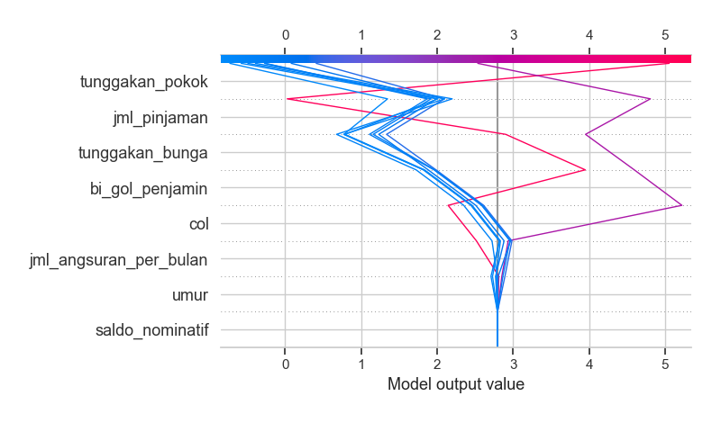
### Top-10 Best decisions for class 0 (Fold 1)
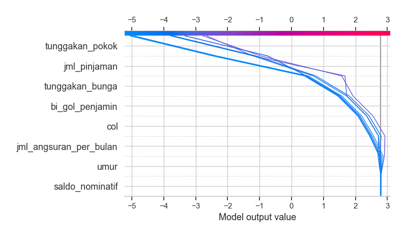
### Top-10 Worst decisions for class 1 (Fold 1)
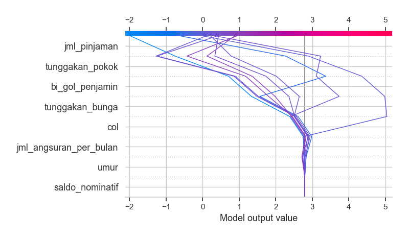
### Top-10 Best decisions for class 1 (Fold 1)
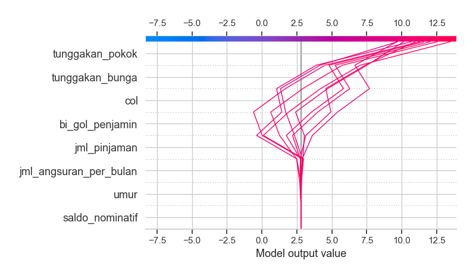

[<< Go back](../README.md)
