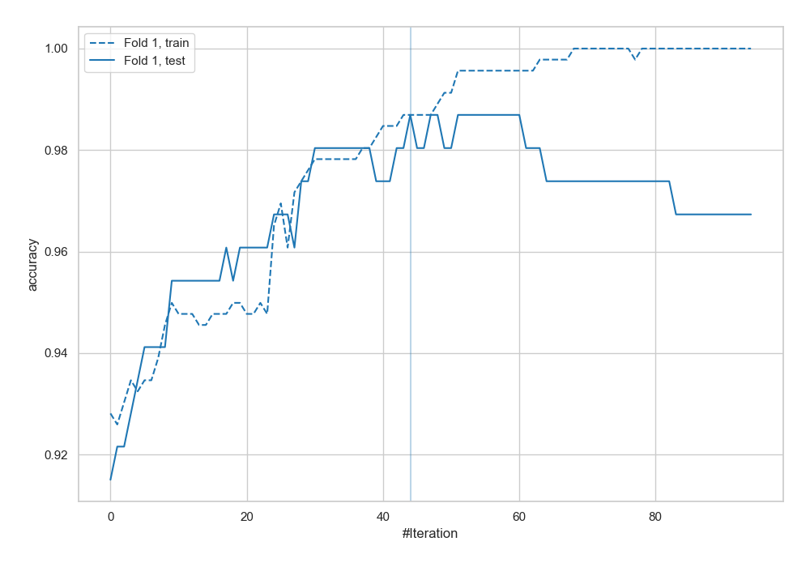
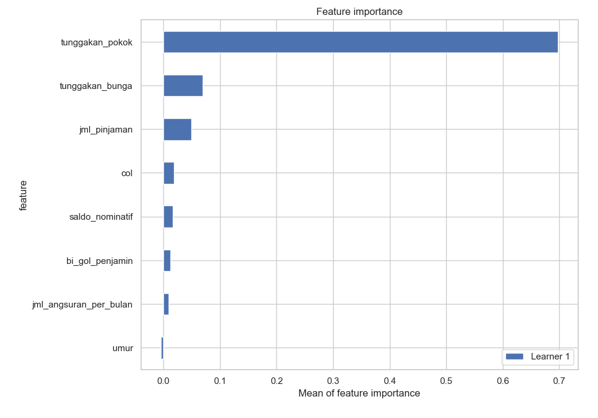
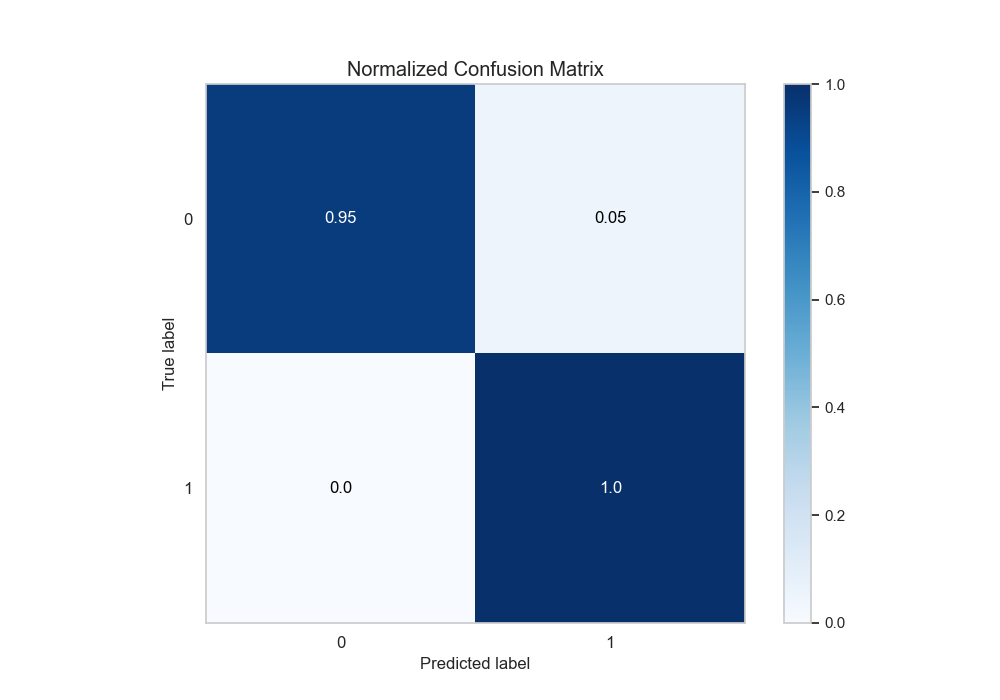
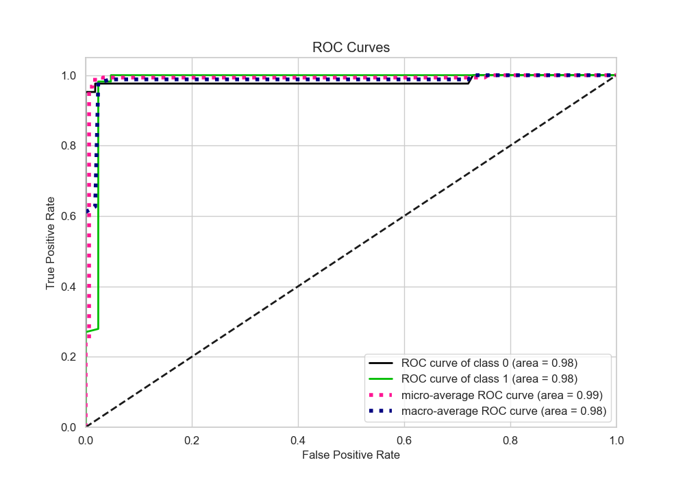
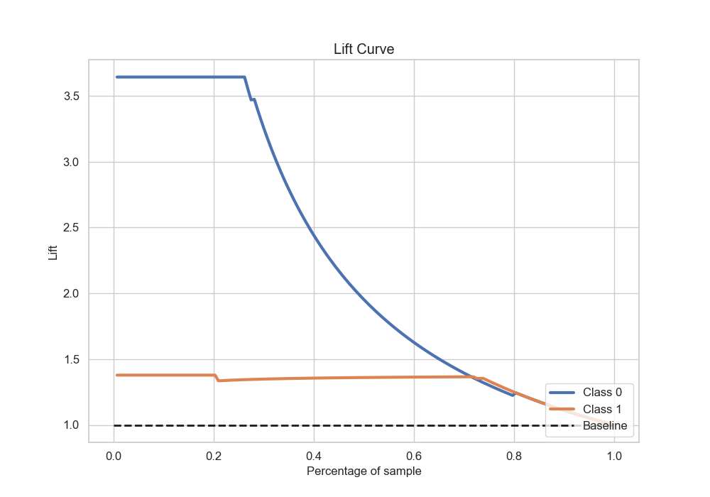

# Summary of 6_Default_CatBoost

[<< Go back](../README.md)

## CatBoost
- **n_jobs**: -1
- **learning_rate**: 0.1
- **depth**: 6
- **rsm**: 1
- **loss_function**: Logloss
- **eval_metric**: Accuracy
- **explain_level**: 2

## Validation
 - **validation_type**: split
 - **train_ratio**: 0.75
 - **shuffle**: True
 - **stratify**: True

## Optimized metric
accuracy

## Training time

5.0 seconds

## Metric details
|           |    score |    threshold |
|:----------|---------:|-------------:|
| logloss   | 0.100003 | nan          |
| auc       | 0.982304 | nan          |
| f1        | 0.991071 |   0.491854   |
| accuracy  | 0.986928 |   0.491854   |
| precision | 0.990909 |   0.623877   |
| recall    | 1        |   0.00815147 |
| mcc       | 0.967225 |   0.491854   |

## Metric details with threshold from accuracy metric
|           |    score |   threshold |
|:----------|---------:|------------:|
| logloss   | 0.100003 |  nan        |
| auc       | 0.982304 |  nan        |
| f1        | 0.991071 |    0.491854 |
| accuracy  | 0.986928 |    0.491854 |
| precision | 0.982301 |    0.491854 |
| recall    | 1        |    0.491854 |
| mcc       | 0.967225 |    0.491854 |

## Confusion matrix (at threshold=0.491854)
|              |   Predicted as 0 |   Predicted as 1 |
|:-------------|-----------------:|-----------------:|
| Labeled as 0 |               40 |                2 |
| Labeled as 1 |                0 |              111 |

## Learning curves

## Permutation-based Importance

## Confusion Matrix

## Normalized Confusion Matrix

## ROC Curve

## Kolmogorov-Smirnov Statistic

## Precision-Recall Curve

## Calibration Curve

## Cumulative Gains Curve

## Lift Curve

[<< Go back](../README.md)
