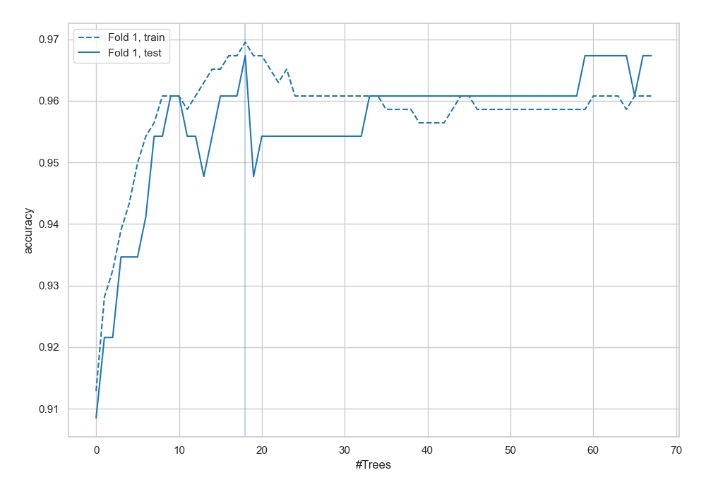
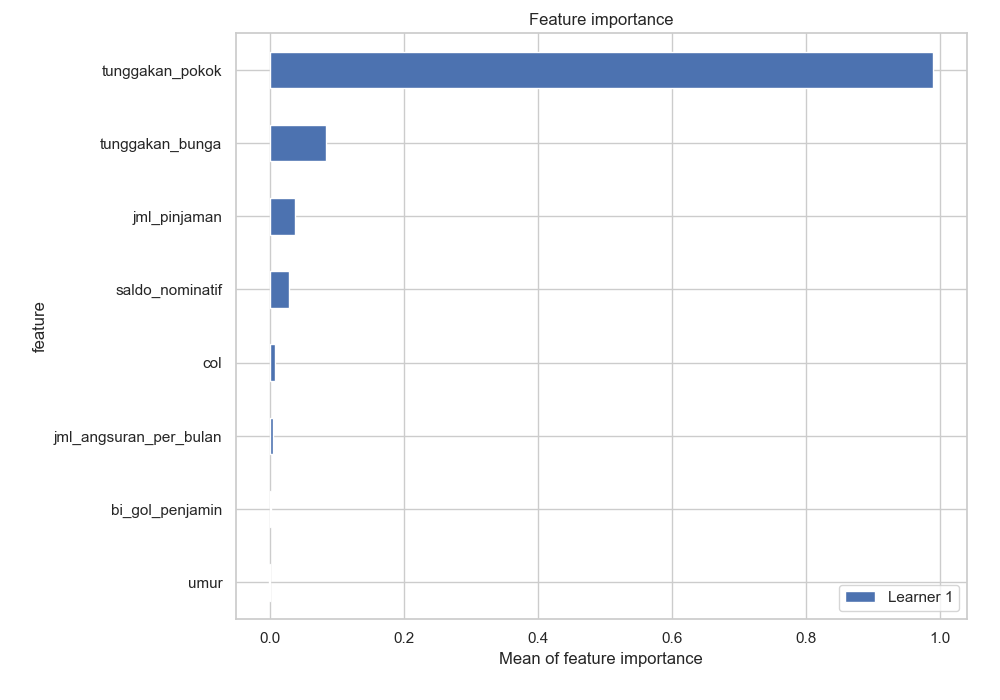
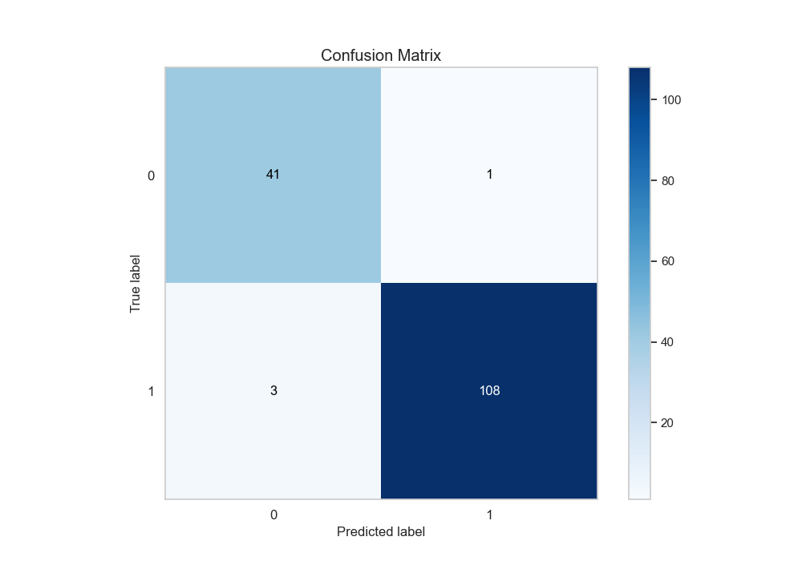
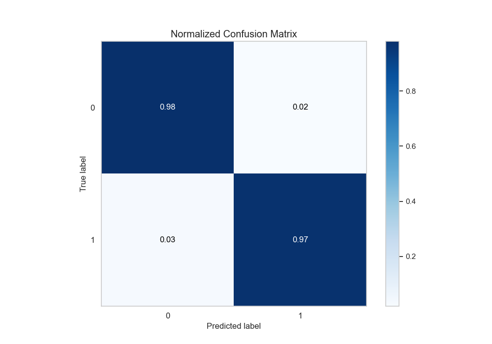
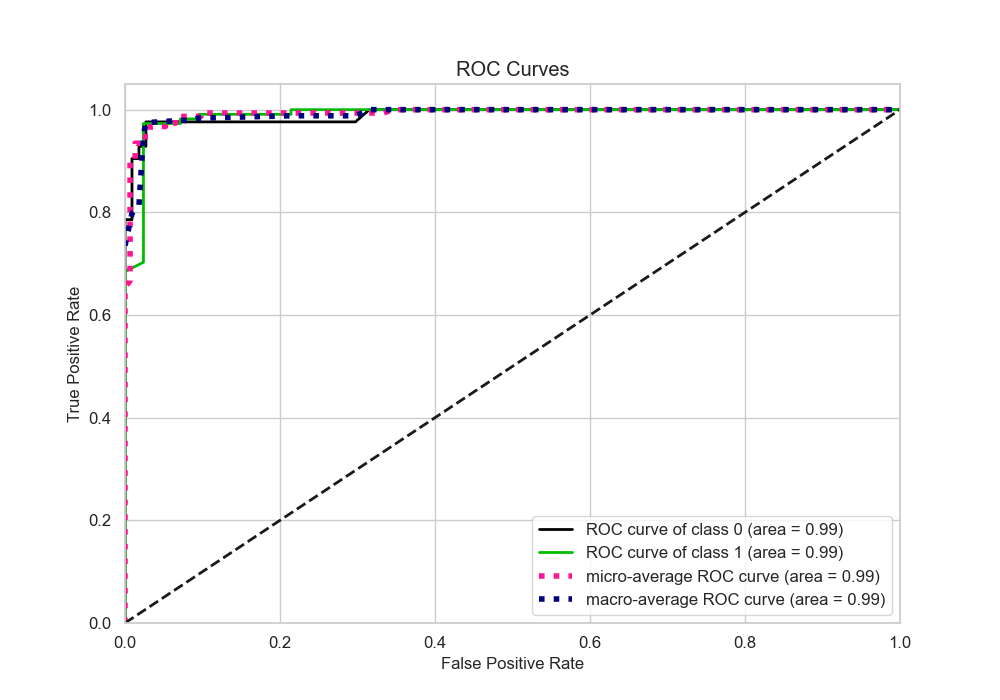
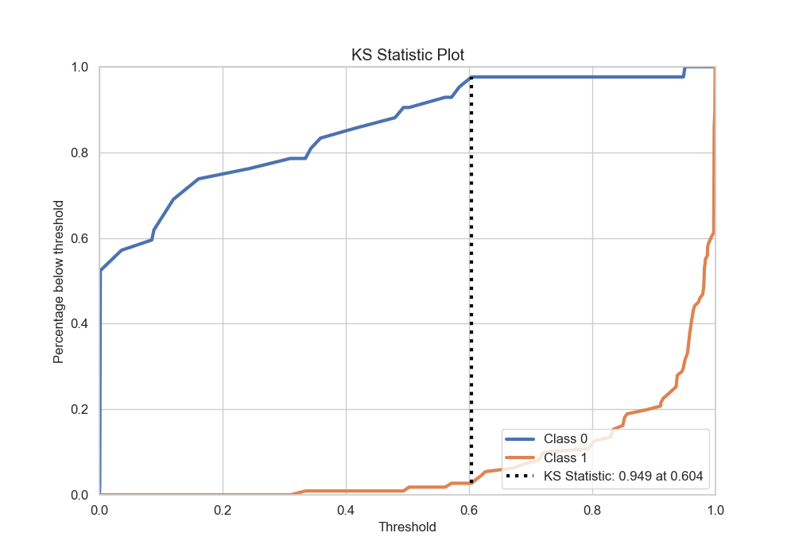
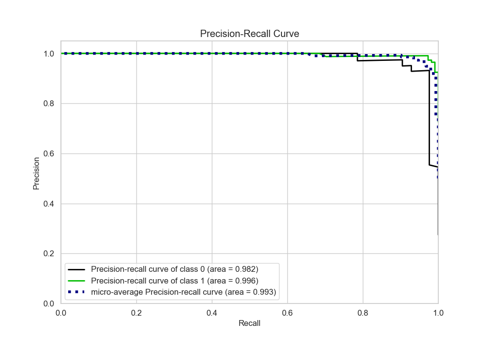
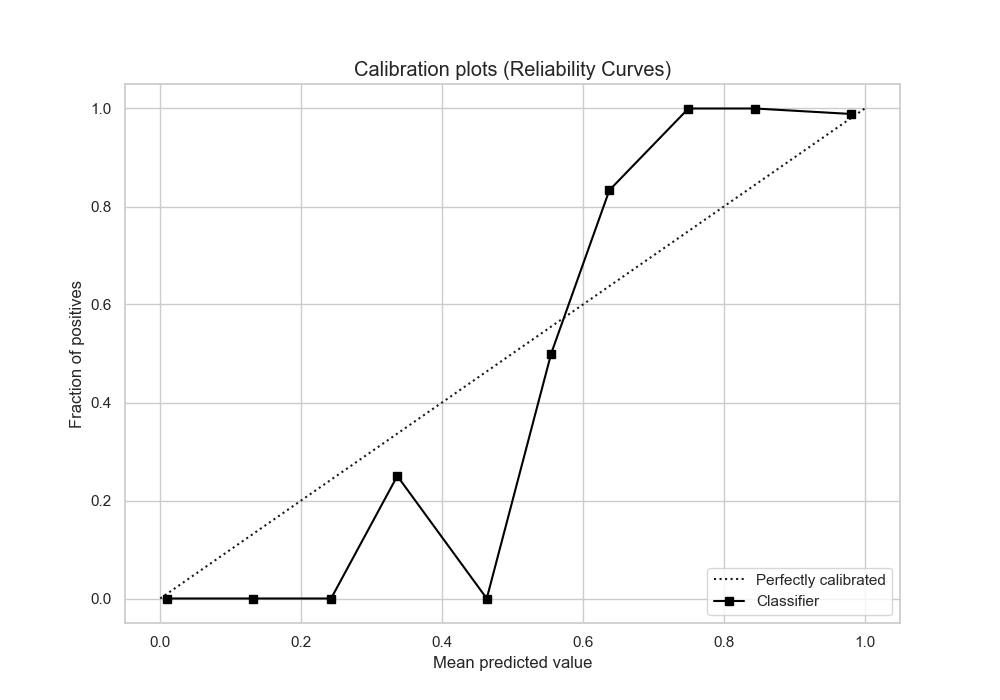
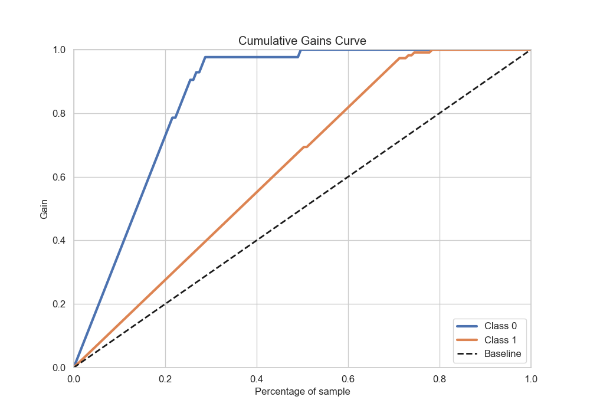
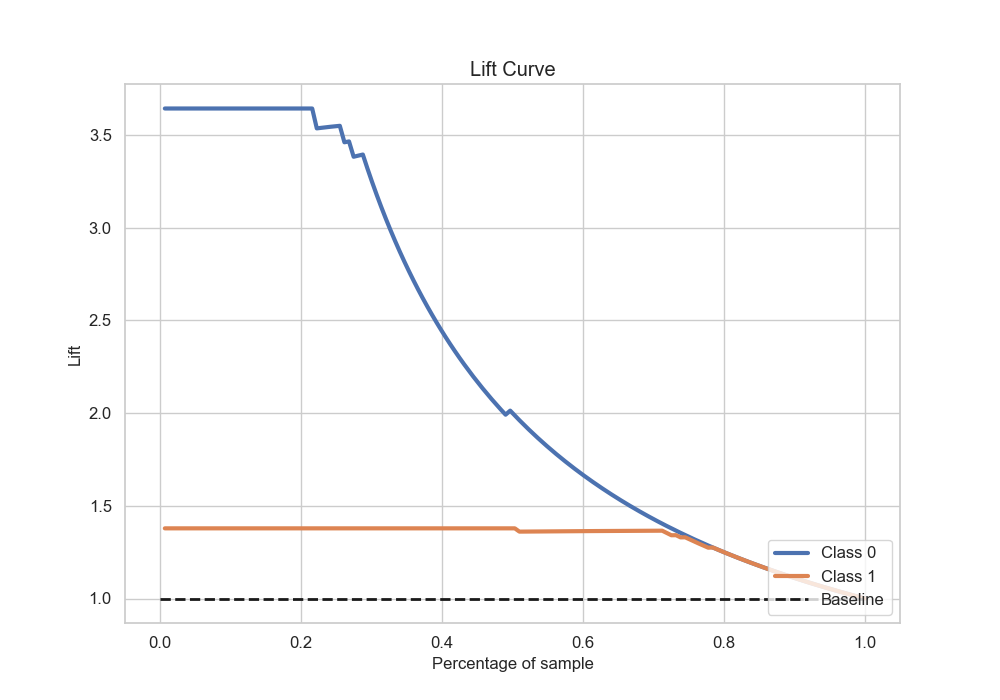

# Summary of 8_Default_RandomForest

[<< Go back](../README.md)

## Random Forest
- **n_jobs**: -1
- **criterion**: gini
- **max_features**: 0.9
- **min_samples_split**: 30
- **max_depth**: 4
- **eval_metric_name**: accuracy
- **explain_level**: 2

## Validation
 - **validation_type**: split
 - **train_ratio**: 0.75
 - **shuffle**: True
 - **stratify**: True

## Optimized metric
accuracy

## Training time

12.8 seconds

## Metric details
|           |    score |     threshold |
|:----------|---------:|--------------:|
| logloss   | 0.126708 | nan           |
| auc       | 0.989918 | nan           |
| f1        | 0.981818 |   0.607851    |
| accuracy  | 0.973856 |   0.607851    |
| precision | 1        |   0.950461    |
| recall    | 1        |   0.000464396 |
| mcc       | 0.93581  |   0.607851    |

## Metric details with threshold from accuracy metric
|           |    score |   threshold |
|:----------|---------:|------------:|
| logloss   | 0.126708 |  nan        |
| auc       | 0.989918 |  nan        |
| f1        | 0.981818 |    0.607851 |
| accuracy  | 0.973856 |    0.607851 |
| precision | 0.990826 |    0.607851 |
| recall    | 0.972973 |    0.607851 |
| mcc       | 0.93581  |    0.607851 |

## Confusion matrix (at threshold=0.607851)
|              |   Predicted as 0 |   Predicted as 1 |
|:-------------|-----------------:|-----------------:|
| Labeled as 0 |               41 |                1 |
| Labeled as 1 |                3 |              108 |

## Learning curves

## Permutation-based Importance

## Confusion Matrix

## Normalized Confusion Matrix

## ROC Curve

## Kolmogorov-Smirnov Statistic

## Precision-Recall Curve

## Calibration Curve

## Cumulative Gains Curve

## Lift Curve

[<< Go back](../README.md)
