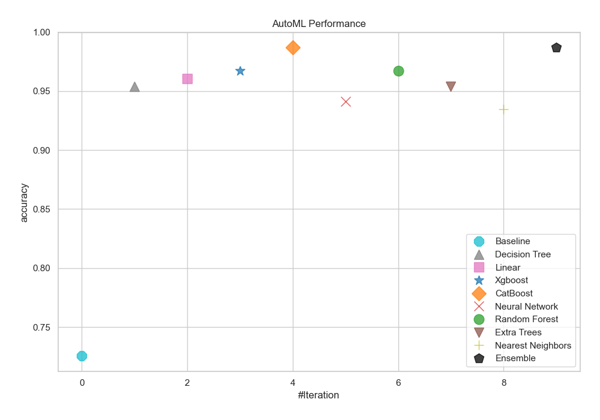
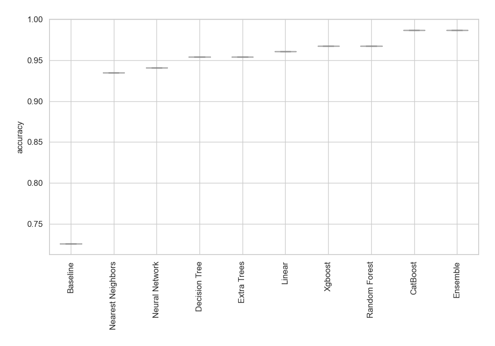
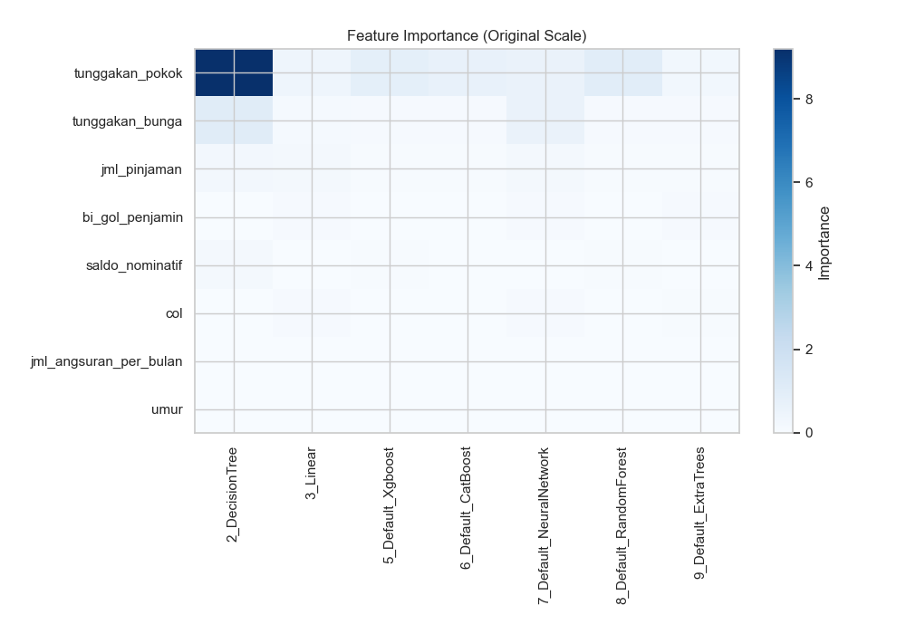
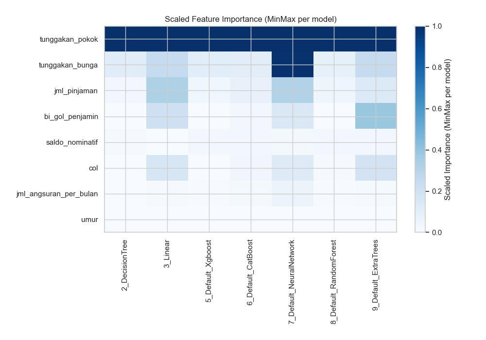
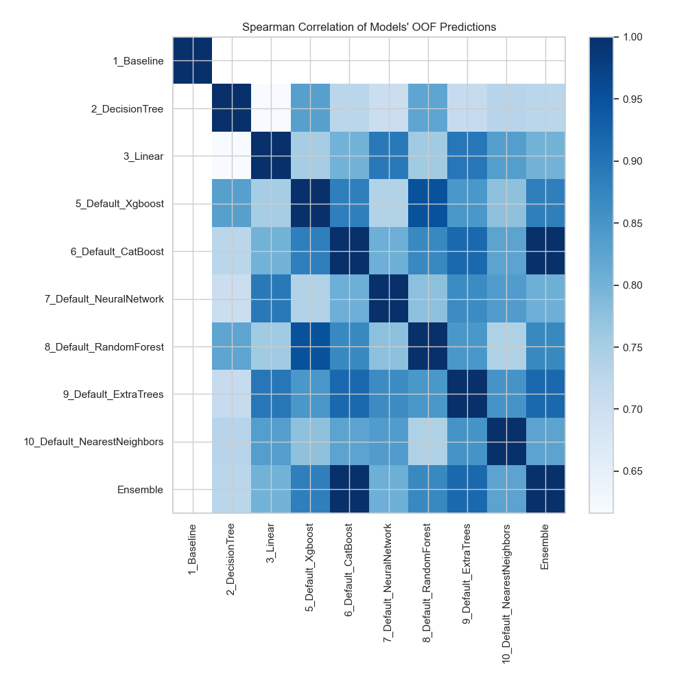

# AutoML Leaderboard

> Models in this report were generated and selected automatically by MLJAR AutoML. Review model behavior, data suitability, and decision impact before important use.

| Best model   | name                                                                 | model_type        | metric_type   |   metric_value |   train_time |
|:-------------|:---------------------------------------------------------------------|:------------------|:--------------|---------------:|-------------:|
|              | [1_Baseline](1_Baseline/README.md)                                   | Baseline          | accuracy      |       0.72549  |         2.11 |
|              | [2_DecisionTree](2_DecisionTree/README.md)                           | Decision Tree     | accuracy      |       0.954248 |        15.98 |
|              | [3_Linear](3_Linear/README.md)                                       | Linear            | accuracy      |       0.960784 |        22.16 |
|              | [5_Default_Xgboost](5_Default_Xgboost/README.md)                     | Xgboost           | accuracy      |       0.96732  |        18.28 |
| **the best** | [6_Default_CatBoost](6_Default_CatBoost/README.md)                   | CatBoost          | accuracy      |       0.986928 |         7.19 |
|              | [7_Default_NeuralNetwork](7_Default_NeuralNetwork/README.md)         | Neural Network    | accuracy      |       0.941176 |         7.05 |
|              | [8_Default_RandomForest](8_Default_RandomForest/README.md)           | Random Forest     | accuracy      |       0.96732  |        14.69 |
|              | [9_Default_ExtraTrees](9_Default_ExtraTrees/README.md)               | Extra Trees       | accuracy      |       0.954248 |         8.13 |
|              | [10_Default_NearestNeighbors](10_Default_NearestNeighbors/README.md) | Nearest Neighbors | accuracy      |       0.934641 |         4.92 |
|              | [Ensemble](Ensemble/README.md)                                       | Ensemble          | accuracy      |       0.986928 |         2.81 |

### AutoML Performance

### AutoML Performance Boxplot

### Features Importance (Original Scale)

### Scaled Features Importance (MinMax per Model)

### Spearman Correlation of Models

